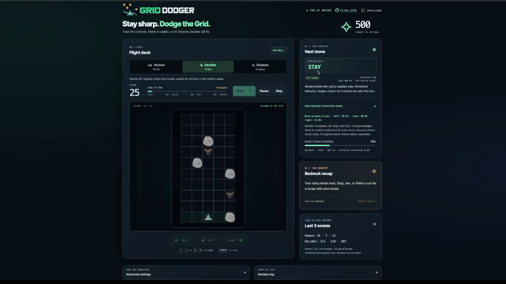

# Grid Dodger

**A small model. Every move matters.**

An arcade game where **Strands Decider 2B chooses how to move** and **Amazon Bedrock turns each finished run into a short recap**. Play it yourself, hand the controls to the model, or use its suggestions as a copilot.

[Watch the demo](https://elyas-syed.github.io/grid-dodger/#demo) · [Read the build story](docs/grid-dodger-article/ARTICLE.md) · [Reuse the decision pattern](docs/DECIDER_PATTERN.md) · [Explore the benchmarks](benchmarks/results/REPORT.md)



## About the project

Most AI demos show you an answer. Grid Dodger lets you watch a decision happen: a ship changes lanes, a hazard falls, and the next choice arrives.

The goal is simple: dodge asteroids and enemy fighters on a five-lane grid and reach **500 points**. Difficulty starts rising at **100 points**, making later decisions harder. Every move advances the board.

We built the game to explore a practical question: **what happens when a small decision model sits directly in an application's action loop?** A game makes its choices visible and gives us a repeatable way to compare prompts, inspect timing, and learn where application logic still matters.

## Three ways to play

| Mode | What happens |
| --- | --- |
| **Human** | You read the board and steer the ship. |
| **Decider** | The model chooses left, stay, or right; the game executes the move. |
| **Shadow** | You stay in control while Decider suggests your next move. |

Use **←/→ or A/D** to steer, **Space** to stay, **R** to reset, and **M** to mute. Touch controls are also available. Pause/Resume continues the current run; Stop ends it and requests a recap.

The copilot panel shows the selected action, move preferences, and decision time. The recap explains the finished run, while the score history keeps your last three Human and Decider results.

## What Strands Decider 2B does

Strands Decider 2B is a small, open-source decision model from AWS. Give it context, a question, and a fixed set of options; your application acts on the result.

In Grid Dodger, the decision pattern is **tool selection**:

1. **Observe:** the game describes the board and calculates the immediate outcome of each possible move.
2. **Choose:** Decider receives that context and selects left, stay, or right.
3. **Act:** the application validates the choice, applies its configured policy, and dispatches a registered movement tool.
4. **Recap:** after the run, Amazon Nova Lite on Bedrock writes a short summary from the score, outcome, and recent moves.

The model selects the action; the game engine executes it and checks collisions. Move probabilities express **relative preference**, not the chance of surviving. The default **0.40** threshold may replace a model choice with stay, which can still collide. The interface distinguishes the model's choice from the applied action.

The [reusable decision recipe](docs/DECIDER_PATTERN.md) includes the typed question, options, tool wiring, and a short usage guide for adapting the pattern to another agent.

## Run locally

### Try the game first

Requires **Node.js 20+**. Python 3 is also needed to run the Lambda tests.

```sh
git clone https://github.com/elyas-syed/grid-dodger.git
cd grid-dodger
npm ci
make test
make serve
```

Open **http://127.0.0.1:8080/game/**. Choose Human mode to steer yourself, or select the **mock** backend for offline practice. Mock decisions use a local heuristic, not the Decider model.

### Play with real Decider inference

Follow the [local setup guide](docs/LOCAL_SETUP.md) to install the model server and run the benchmarked checkpoint on Apple Silicon MPS or CPU. Keep the model server and game server running, then select **strands-decider (http)** in Advanced settings with the URL **`/decider`**.

Local movement decisions require no AWS hosting. Performance depends on your hardware, and the initial model download needs internet access. Bedrock recaps are optional paid AWS calls; without them, run endings use a labeled offline recap.

## Architecture


The AWS reference deployment serves the browser UI through **S3 and CloudFront**. Movement requests reach **Decider on GPU-backed ECS/EC2**; recap requests reach **API Gateway and Lambda**, which call Amazon Bedrock. **CodeBuild and ECR** build and store the model-serving image.

The local setup keeps the same browser decision flow, using a Node server to proxy requests to the model running on your computer. See the [AWS deployment guide](terraform/README.md) for cloud provisioning, image builds, frontend updates, and teardown.

## What the measurements showed

Giving Decider explicit move outcomes helped more than leaving it to infer those consequences from a less grounded question.

| Measurement | Recorded result |
| --- | --- |
| Avoidable collisions, original → grounded prompt | **17/31 → 0/31** |
| Grounded prompt median snapshot request time | **422 ms** |
| Grounded prompt p95 snapshot request time | **519 ms** |
| Mean episode length, grounded prompt | **51 of 60 moves** |
| Grounded runs reaching the test limit | **4 of 5** |

The benchmark used **40 fixed board snapshots and five episodes per variant**, capped at 60 moves. The rule-based baseline also avoided every avoidable snapshot collision and was much faster. Decider timings include HTTP and network overhead. These exploratory results do not establish a general survival rate or savings against larger models.

Read the [methodology, comparisons, and raw results](benchmarks/results/REPORT.md).

## Demo, hosting, and costs

The [project website](https://elyas-syed.github.io/grid-dodger/) includes an approximately **80-second recording of real AWS gameplay**, with audio and synchronized commentary. Watching it makes no model requests. The recording environment has been removed; there is no always-on hosted game.

| Setup | Running-cost context |
| --- | --- |
| **Local game and Decider** | No AWS hosting charges; use your own hardware. Optional Bedrock recaps are billed separately. |
| **Full AWS reference stack** | Approximately **$14/day or $425–430 per 730-hour month**, before credits and tax; builds and usage are additional. The GPU dominates. |
| **Recorded website** | Static GitHub Pages hosting, without the live inference stack. |

See the [cost assumptions and breakdown](docs/COSTS.md) before deploying AWS resources.

To preview the published showcase locally after installing dependencies:

```sh
npm run build:pages
python3 -m http.server 8082 --directory _site
```

Open **http://127.0.0.1:8082/**. GitHub Actions validates the project and publishes only `_site/` on pushes to `main`. [GitHub Pages guide](docs/GITHUB_PAGES.md).

## Project guide

| Location | Contents |
| --- | --- |
| `game/` | Browser arcade, movement controls, model details, and recap UI. |
| `game/landing/` | Static showcase, recorded demo, and synchronized commentary. |
| `examples/` | Reusable decision-pattern examples. |
| `benchmarks/` | Recorded benchmark results and evidence. |
| `terraform/` | AWS reference infrastructure and deployment instructions. |
| `tests/` | Automated game, integration, and recap checks. |
| `docs/` | Local setup, decision recipe, architecture, costs, and build article. |

[Game specification](docs/SPEC.md) · [Local setup](docs/LOCAL_SETUP.md) · [Decision recipe](docs/DECIDER_PATTERN.md) · [Contributing](CONTRIBUTING.md)

Built by [Elyas Syed](https://github.com/elyas-syed).

Hackathon pattern: **tool selection**. Tags: **#strands-decider-2b #tool-selection**.

[Apache-2.0 code license](LICENSE) · [Artwork and audio attribution](game/assets/ATTRIBUTION.txt)
