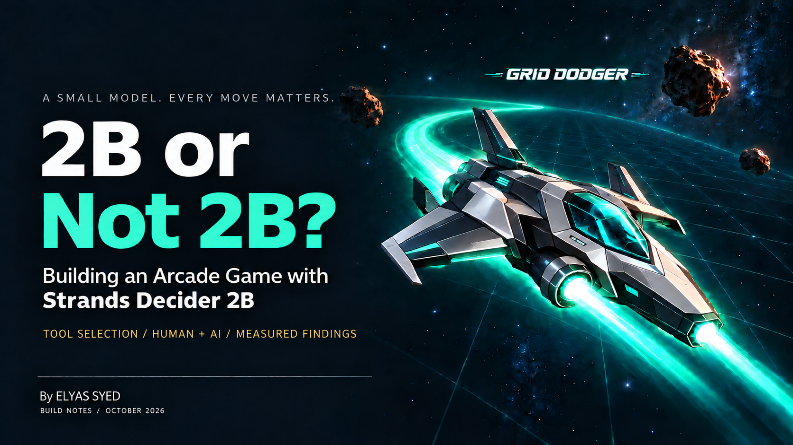
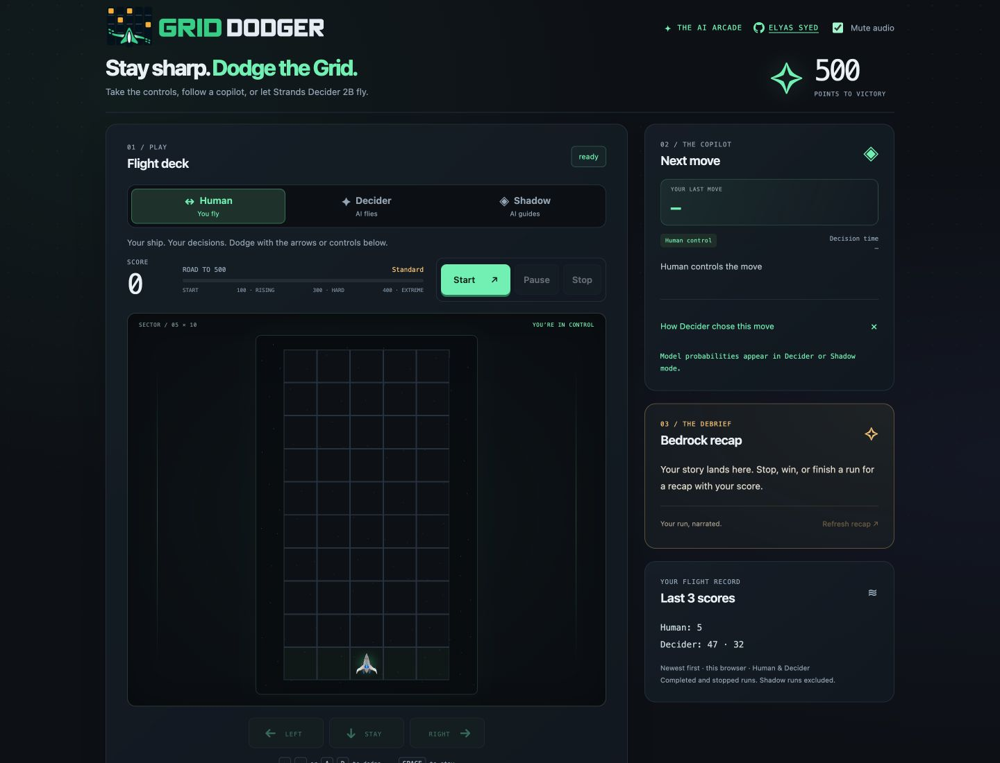
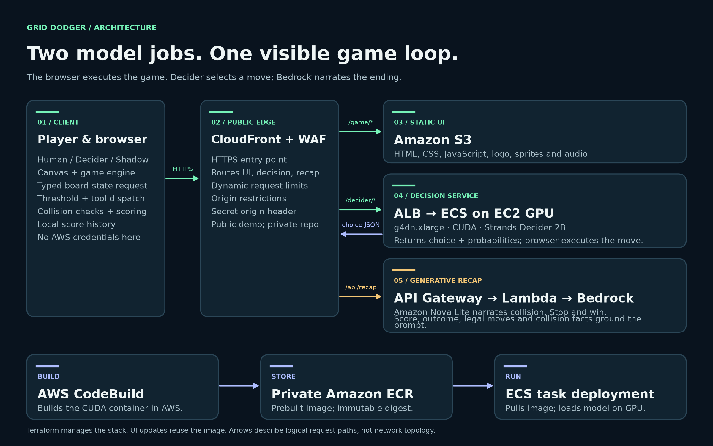
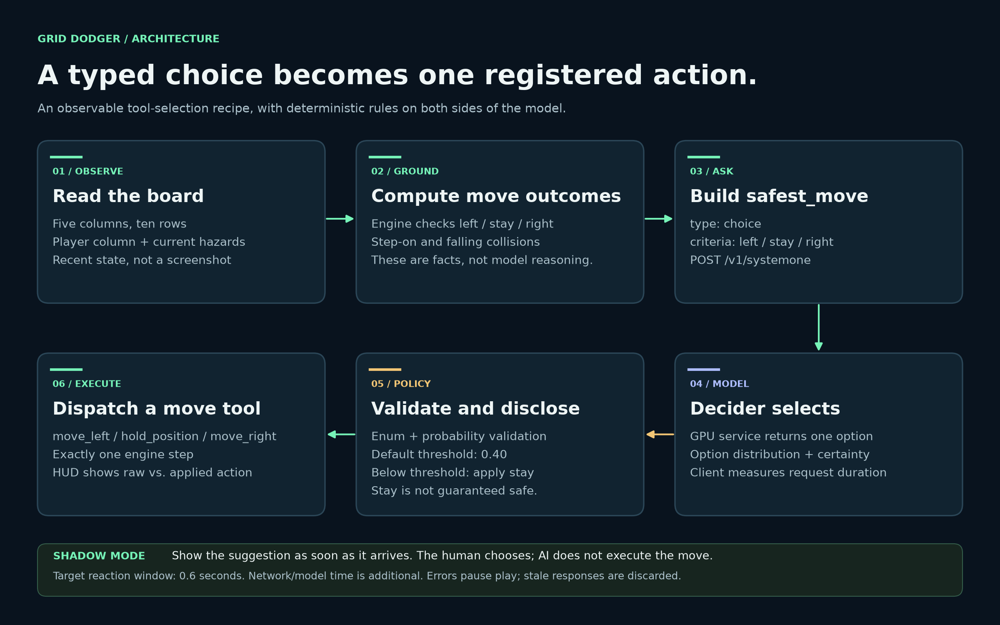
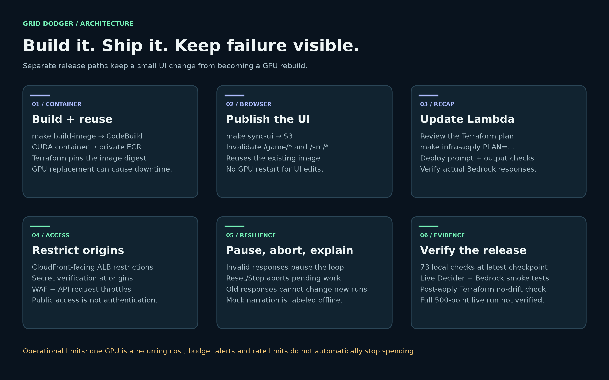
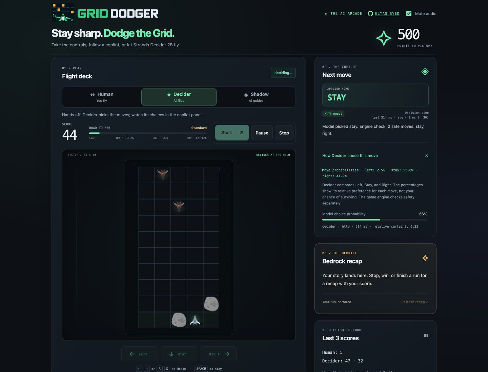
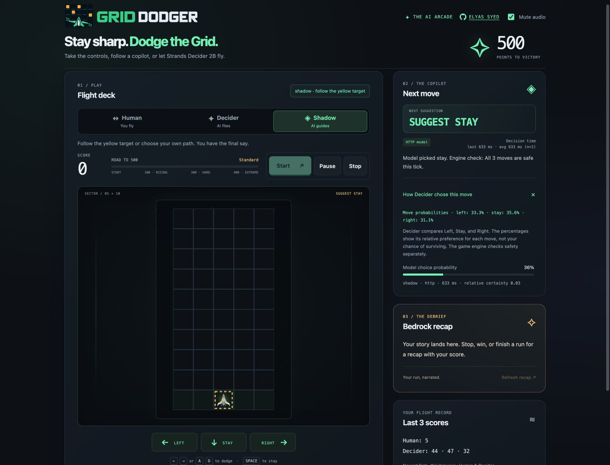
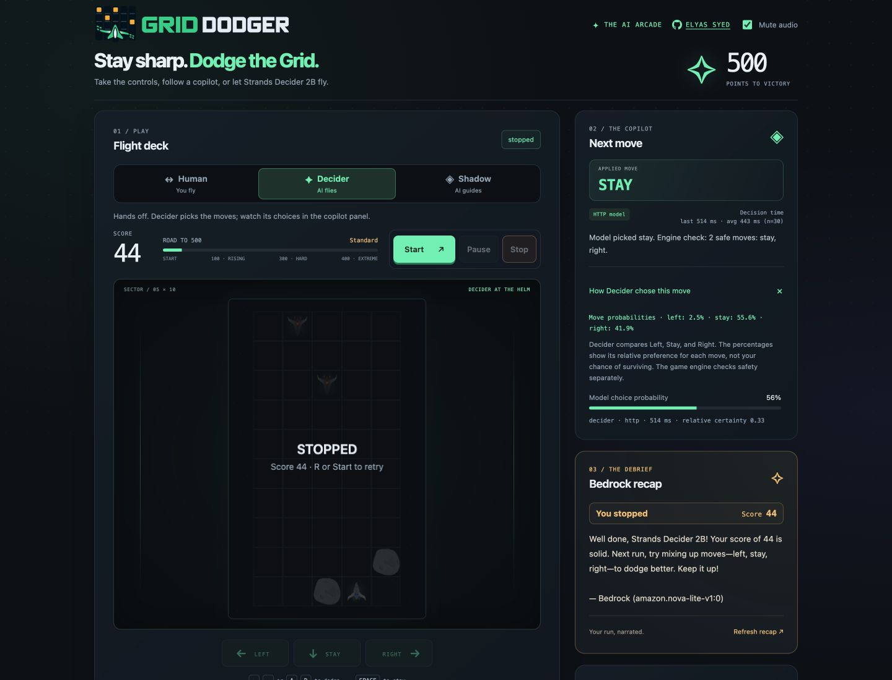
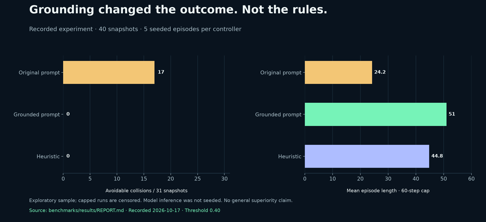

# 2B or Not 2B? Building Grid Dodger with Strands Decider 2B

**By Elyas Syed · October 23, 2026**
*Tool selection · #strands-decider-2b #tool-selection*



What happens when you give a small decision model the controls to an arcade game?

I built Grid Dodger to find out. The model gets three choices: left, stay, or right. Falling hazards make the consequences easy to see. Sometimes the ship dodges. Sometimes the answer arrives in perfectly valid JSON and the ship crashes anyway.

That gave me something useful to work on: a game I could play myself, hand over to the model, or use to compare our decisions side by side. Along the way, I had to fix the information we gave the model, rethink how we displayed its probabilities, and make its suggestions arrive early enough to help a human player.

Before getting into the game, it helps to explain the model at the center of it.

## What is Strands Decider 2B?

Strands Decider 2B is a small, open-source model for making decisions inside an application. You give it a situation and a typed question. Instead of writing a paragraph, it selects an option, answers yes or no, or assigns a score. For Grid Dodger, the question is simply which movement option to choose. [Official introduction](https://strandsagents.com/blog/introducing-strands-decider/)

Think of an agent that has several tools available. A generative model might write the eventual answer, but first the application needs to choose a tool. That smaller choice is the kind of job Decider is intended to handle.

Our deployment uses **`StrandsAgents/strands-decider-2B-hobson-v19`**. Its model card describes a Qwen3.5-2B base with an adapter and a decision head. It also warns that confidence calibration needs testing on your own workload. The project now has newer checkpoints; the results in this article belong to the v19 setup we actually ran. [Checkpoint model card](https://huggingface.co/StrandsAgents/strands-decider-2B-hobson-v19)

I paired it with **Amazon Bedrock**, using **Amazon Nova Lite** for the post-game recap. The two models have separate jobs: Decider chooses a movement option; Bedrock writes a short summary after the run ends.

## Why build a game around it?

I wanted to see the decision happen, then immediately see what it did.

A game gives that experiment a clear boundary. There are only three legal moves. The rules live in code. A poor choice has an obvious consequence, and I can replay the same board with a different prompt or controller.

It also makes the experiment approachable. You do not have to read a trace or understand the request schema to notice that staying put was a bad idea. You can take the controls yourself, watch the AI fly, or ask it for suggestions while you keep playing.

That last option became Shadow mode, and it turned out to be one of the most useful parts of the project. It lets you disagree with the model before its choice becomes your action.

## Meet Grid Dodger



*The actual hosted game. The opening Human-mode screen explains that model probabilities appear only when a model is involved.*

The board has five columns and ten rows. Your ship sits at the bottom. You can move one column left, stay where you are, or move one column right. Hazards advance one row at a time. Reach **500 points** to win.

| Mode | How it plays |
|---|---|
| **Human** | You steer with the keyboard or movement buttons. |
| **Decider** | The model chooses, the configured policy checks the response, and the game executes the selected movement tool. |
| **Shadow** | The model suggests a move and shows a yellow target. You make the final choice. |

Difficulty starts increasing at 100 points, reaches Hard at 300 and Extreme at 400. The hazards become denser; they do not suddenly start falling several rows at once.

Pause lets you continue the same run. Stop ends it deliberately and requests a recap. Collisions and wins also trigger recaps. Recent Human and Decider scores are saved in the browser, so you can compare your own runs without setting up an account.

**[Watch the recorded demo](https://elyas-syed.github.io/grid-dodger/#demo)** or [run the game locally](../LOCAL_SETUP.md). The recording shows the real AWS deployment. That temporary inference stack has been removed to stop hosting charges; the showcase is static.

## How the project works



*The browser runs the game. The GPU service returns a decision; the recap service returns text.*

The frontend is JavaScript and canvas, served from S3 through CloudFront. The same CloudFront address also exposes the two backend routes:

- **`/decider/*`** goes through an Application Load Balancer to an ECS task on an EC2 `g4dn.xlarge` GPU instance.
- **`/api/recap`** goes through API Gateway to a Python Lambda function that calls Bedrock.

The distinction I want to make clear is where execution happens. Decider does not directly change the ship’s position on the GPU server. It returns an answer. The browser validates that answer, applies the threshold policy, and calls a registered movement tool. The game engine owns movement, scoring and collision detection.

Bedrock sits outside that movement loop. When a run ends, it receives the outcome, score, pilot mode, recent moves and any validated collision evidence. Its response appears in the recap panel.

## From a board to a move



*The same selection path supports automatic play and human-controlled Shadow suggestions.*

Suppose the ship is in column 2 and a hazard is about to fall into that column. The game can calculate the immediate result of each legal move. In this example, left and right are safe for the next step; stay causes a collision.

We send those facts with a typed question named `safest_move`. A shortened example looks like this:

```json
{
  "state": "Player in column 2; approaching hazard in column 2...",
  "questions": {
    "safest_move": {
      "type": "choice",
      "instructions": "Choose a SAFE move from the explicit move outcomes...",
      "criteria": {
        "left": "SAFE this tick; destination column 1",
        "stay": "COLLISION: game ends; destination column 2",
        "right": "SAFE this tick; destination column 3"
      }
    }
  }
}
```

The engine generates the criteria for each board. The example is abbreviated, rather than a complete request copied from a running session.

The option keys map to three tools: `move_left`, `hold_position`, and `move_right`. Each executes one engine step. Unknown option names cannot call arbitrary functions.

Before dispatch, the policy checks the returned option and its probability. The current threshold is **0.40**. Below it, the game applies `stay`. That fallback can still collide, so the interface shows when the applied action differs from the model’s original choice. It is a policy we can evaluate and change, not a safety guarantee.

In Shadow mode, we stop short of executing the AI’s choice. We display the suggestion and let the human decide.

## Building the first working version

I started with a small browser game and kept the engine separate from the interface. That made it possible to test movement, collisions and scoring without clicking through the page every time something changed.

Next came the HTTP decision path: format the board, send the typed question, parse the response, and bind the result to one of the movement tools. A mock controller kept local development useful when the real model was unavailable. The interface labels that mode so it cannot be mistaken for live inference.

For AWS, we built the CUDA container in CodeBuild and stored it in private ECR. ECS pulls that image onto the GPU instance, and Terraform pins the task to an immutable image digest. The recorded clean build took about **5 minutes 28 seconds** and produced a **3.43 GB compressed image**. Future builds can take a different amount of time.



*Separate release paths mean that changing a button or a recap prompt does not require rebuilding the GPU image.*

The Make commands reflect those boundaries:

| Change | Command or workflow |
|---|---|
| Run local checks | `make test` |
| Rebuild the Decider container | `make build-image` |
| Update Lambda or infrastructure | Review a Terraform plan, then `make infra-apply PLAN=reviewed.tfplan` |
| Publish browser assets | `make sync-ui` |

We also exercised a full teardown and rebuild. That helped catch assumptions that a working deployment can hide. Fresh hosts still need to pull the image and load the model, and replacing a task on one GPU can interrupt the service.

The demo has origin restrictions, a verification header, WAF limits and recap throttling. Those reduce direct access and abuse; they do not make a public game authenticated or give it a spending cap.

## What went wrong, and what we changed

### The model kept choosing stay

The first prompt described the approaching hazards and asked for the safest move. That sounded reasonable, but valid responses could still leave the ship in an imminent collision path.

We improved the input by spelling out the immediate outcome of each candidate move. The formatter checks both moving onto a hazard already at the bottom and a hazard falling onto the destination afterward. The order matters because the player moves before the hazards advance.

This was an input change, not evidence that the model learned collision detection. We computed those facts ourselves. A rules-based controller can use them too, which is why the benchmark includes a heuristic baseline.

### The percentages made the model look worse than the decision



*Captured during a real HTTP-model run. The probabilities are the values returned by the model.*

An early version showed a single percentage and an “unsure” warning. When several moves were safe, a roughly even split looked like a failure. But a 35% preference for one of three reasonable moves is not the same as a 35% chance of survival.

We removed the generic warning and made the explanation clearer. The panel now distinguishes the model’s choice, any policy override, and the engine’s safe-move facts. It shows the full distribution, labels missing probabilities unavailable, and displays decision time separately. We did not change the numbers to make them look more impressive.

There are two numeric signals worth keeping apart: the chosen option’s probability drives our policy, while the response’s confidence is retained under the legacy `reliability` name for the relative-certainty display. Neither should be casually relabeled as a survival prediction.

### Shadow suggestions arrived too late to help



*The yellow target marks the current suggestion. The player still decides whether to follow it.*

It was not enough for the suggestion to be correct. The player needed time to use it.

We kept the **0.6-second reaction target**, requested each new suggestion as soon as the next board was known, and displayed it immediately on response. Model and network time are additional, so the entire cycle is not guaranteed to finish in 600 ms. Early keypresses are preserved.

We also stopped replacing the card’s values with a waiting state on every request. The previous metrics remain readable while the next result is pending, but the ghost target only appears for a suggestion that matches the current board.

That same feedback shaped the rest of the UI: compact movement cards, horizontal pilot controls, a visible recap panel, and Start scrolling a new run into view while Resume preserves the player’s position.

### The recap invented moves the game did not have



*The footer identifies Bedrock as the source. The praise and advice are generated commentary, not a verified explanation of the run.*

The narrator once suggested diagonal movement. There are no diagonals in Grid Dodger. It also called the score “ticks,” because that was how our prompt described it.

We changed the prompt to use **points for scores** and **moves for actions**, supplied the legal action set, and labeled the move history as a recent sample rather than the whole run. Stop and win use a fixed outcome-and-score opening, with collision evidence removed for those outcomes.

We screen for excessive length, unsupported mechanics and internal tick terminology. If the response fails those checks, the application shows an explicitly labeled offline fallback. This catches specific problems; it does not verify every piece of advice. Repeated scores and questionable praise remain possible.

## What the measurements actually say

We recorded **40 fixed board snapshots** and **five seeded episodes per controller**, capped at 60 engine steps. The compared controllers were the reconstructed original prompt, the grounded prompt, and a local deterministic heuristic. Snapshot cases are shared. Spawn randomness is seeded for episodes, but model inference is not, and episode states diverge when controllers choose different moves.



*Measured figure. Generated from the stored benchmark report, not from the screenshots in this article. The episode cap censors long runs.*

| Controller | Avoidable collisions / 31 snapshots | Mean episode length in engine steps | Runs reaching cap / 5 | Median request ms | p95 request ms |
|---|---:|---:|---:|---:|---:|
| Local heuristic | 0 | 44.8 | 2 | 0.02 | 0.10 |
| Original prompt | 17 | 24.2 | 0 | 354.66 | 384.74 |
| Grounded prompt | 0 | 51.0 | 4 | 422.06 | 519.09 |

The clear snapshot finding is that grounding eliminated the 17 avoidable collisions observed with the original prompt in this sample. It did not beat the heuristic’s zero.

The grounded model’s five episodes averaged 51.0 engine steps, compared with 24.2 for the original prompt and 44.8 for the heuristic. That is encouraging for these seeds, but five capped episodes cannot establish general superiority.

Grounding also **increased** median snapshot request latency, from approximately 355 to 422 ms; p95 rose from 385 to 519 ms. These are client request timings, including network overhead. The heuristic timings measure local computation and are not an equivalent network request. The official project’s reported hardware-specific latency is not our application latency. [Official performance context](https://strandsagents.com/blog/introducing-strands-decider/)

No frontier-model baseline or monetary savings experiment was measured. The 60-step episodes also stop before the current 100-point difficulty ramp. None of these numbers should be turned into a claim that the current model can reliably win the harder 500-point game.

The [recorded report](../../benchmarks/results/REPORT.md), [raw decisions](../../benchmarks/results/report.json), and [benchmark instructions](../../benchmarks/README.md) preserve the evidence and its limits.

## What it costs to run

The expensive part of this demo is keeping the GPU available, rather than generating the short recap. The project infrastructure was removed on October 17, 2026; the estimates below describe running the full stack again, not its current bill.

At the checked us-east-1 rates, continuous light-traffic hosting is approximately **$14 per 24-hour day, or $425–430 per 730-hour month**, before credits and tax. The daily planning range is $13.97–14.14, calculated as the monthly estimate × 24/730. GPU compute alone is about $12.62/day, or $384/month. The rest covers the load balancer, public IPv4 addresses, disk, WAF, image storage and a small variable-usage allowance.

Storing the approximately 3.43 GB ECR image costs roughly $0.01/day, or $0.34/month. A six-minute large Linux CodeBuild run is about $0.12 before credits. UI releases reuse the image, so they do not incur another container build.

Short Nova Lite recaps add usage-based token charges. The [component estimate](../COSTS.md) lists the assumptions and rates. These are hosting estimates, not evidence that our model-driven game saves money over a frontier-model implementation.

## Where could Decider fit in production?

The game gave us a visible way to try a pattern that could also fit inside a larger agent: let a small model handle a bounded choice, then let application code control what happens next.

Possible uses include selecting a tool, routing a request to a category or model, checking whether tool arguments match supplied information, and ranking context before passing it to a generative model. These are examples of intended decision-model uses, rather than production results demonstrated by Grid Dodger. [Official project](https://github.com/strands-labs/strands-decider)

The potential benefit is avoiding a generative-model call for every small choice. A fixed answer format can simplify parsing, and a self-hosted service gives the builder control over deployment. Whether it is faster or cheaper depends on the request size, hardware, traffic and alternative being replaced. An idle GPU can easily outweigh per-call savings.

I would treat a production trial as a separate evaluation. Start in shadow mode, compare choices with known outcomes, measure end-to-end latency and cost, and test confidence thresholds on representative traffic. Define what happens when the model is wrong or unavailable. Keep permission checks and hard safety rules in deterministic code, and use human review or a stronger fallback where the consequences justify it.

Decider is presented as experimental software. The model card also limits where its calibration claims apply. Grid Dodger does not establish production readiness; it gives us a working place to examine the pattern before making that decision. [Model limitations](https://huggingface.co/StrandsAgents/strands-decider-2B-hobson-v19)

## What another builder can reuse

The most portable part of the project is smaller than the game. The selector and dispatcher in `src/tool-selection.mjs` have no game or AWS dependency. You provide a decision, register the allowed tools, and choose a fallback appropriate to your application.

```js
import { runToolRecipe } from "./src/tool-selection.mjs";

const result = await runToolRecipe({
  // Replace this example response with your normalized Decider result.
  readDecision: async () => ({
    choice: "lookup",
    choiceProbability: 0.8
  }),
  tools: {
    lookup: { execute: () => lookupDocumentation() },
    ask: { execute: () => askForMissingSubject() }
  },
  fallback: "ask",
  threshold: 0.4
});
```

The functions above stand in for your own tools. The [runnable example](../../examples/tool-selection.mjs) supplies demonstration bindings, and the [recipe guide](../DECIDER_PATTERN.md) explains the typed question, options and wiring. Our declared pattern is **tool selection**. We call the Decider HTTP API directly; this project does not implement a Strands Agents `InterventionHandler`.

You can also try it without rebuilding our AWS stack. The game and **real Strands Decider 2B run locally**, with MPS acceleration on Apple Silicon or a CPU fallback. The [local setup guide](../LOCAL_SETUP.md) covers installation, starting both servers, selecting HTTP mode, and checking actual model responses. Performance depends on your computer. Bedrock recaps remain an optional paid AWS call; without AWS access, the game uses a labeled offline recap. Mock mode is a separate heuristic for offline practice.

The latest application checkpoint passed **66 Node checks and 7 Lambda checks**. Separate live checks covered Decider decisions, real Bedrock recaps and access restrictions. A post-deployment Terraform plan showed no changes. A complete live 500-point victory run has not been verified. The container digest is pinned, but the model repository revision and a portable Python dependency lock remain follow-up work. [Validation record](../VALIDATION.md)

What I would try next is more specific than “make the AI better”: run longer episodes through the difficulty ramp, use more seeds, compare fallback policies, and measure whether the probability thresholds help or hurt on the boards we actually see.

For now, I have a game I can play, a model I can watch make decisions, and a record of what changed when we gave it better information. That is a useful place to start.

---

**Project evidence:** [specification](../SPEC.md) · [validation](../VALIDATION.md) · [costs](../COSTS.md) · [reusable recipe](../DECIDER_PATTERN.md)

**Primary references:** [Decider introduction](https://strandsagents.com/blog/introducing-strands-decider/) · [official source](https://github.com/strands-labs/strands-decider) · [v19 model card](https://huggingface.co/StrandsAgents/strands-decider-2B-hobson-v19) · [hackathon requirements](https://builder.aws.com/build/hackathons/4f50957c-1d08-37ab-b11c-97516b9adeb4/agent-experience-hackathon-strands-decider)
